<div align="center">


<a href="https://github.com/SeiKdesu"></a>

<a href="https://x.com/asu_s_k"></a>
<a href="https://github.com/SeiKdesu/Training-Free-Residual-Guided-Retrieval-for-Multi-hop-KGQA"></a>
<a href="https://github.com/SeiKdesu/JSAI_2026"></a>


</div>

<br />


```yaml
name: Keito
based_in: Tokyo, Japan
research:
  focus: [LLM, Knowledge Graph, Multi-hop KGQA, RAG, World Models]
  papers:
    - AACL-IJCNLP 2026  # Training-Free Residual-Guided Retrieval for Multi-hop KGQA
    - JSAI 2026         # 報酬関連領域を強調した Dreamer V3 の表現学習
building: [Flutter, Firebase, Gemini API, Flask]
hardware: Verilog CPU (ROM / RAM / I/O) on FPGA
contact: x.com/asu_s_k
```


<p align="center">
  <a href="https://github.com/SeiKdesu/Training-Free-Residual-Guided-Retrieval-for-Multi-hop-KGQA"></a>
  <a href="https://github.com/SeiKdesu/JSAI_2026"></a>
</p>


<p align="center">
  <a href="https://github.com/SeiKdesu/simple_news_podcaster">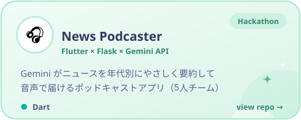</a>
  <a href="https://github.com/SeiKdesu/daigaku_app_firebase"></a>
  <a href="https://github.com/SeiKdesu/gate_level_FPGA">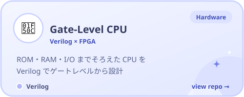</a>
</p>


<p align="center">
  <code>// ai &amp; research</code><br />
  
  <br /><br />
  <code>// apps</code><br />
  
  <br /><br />
  <code>// systems</code><br />
  
</p>


<p align="center">
  
  
</p>

<p align="center">
  <picture>
    <source media="(prefers-color-scheme: dark)" srcset="https://raw.githubusercontent.com/SeiKdesu/SeiKdesu/output/snake-dark.svg" />
    
  </picture>
</p>

